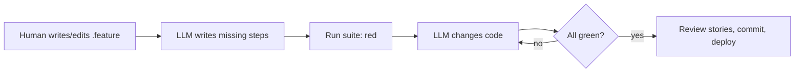

# BDD spec-first feature development (LLM-driven)

The default way to build or change any feature. The human owns the spec (.feature files). The LLM owns the code (step definitions and implementation). This works alongside TDD unit tests: BDD scenarios describe behaviour from the user's side, and unit tests still cover pure logic.

## Loop

## Steps
1. **Spec first.** Write or update a `features/<area>/<name>.feature` file in plain user language (Feature / Scenario / Given / When / Then / And). Given is the starting state, When is the single action, Then is the observable result. Use one feature file per area and keep scenarios small and concrete, with real example values. Cover the happy path, edge cases, permissions and clarification flows.
2. **Get the spec confirmed.** Show the scenarios to the user before coding when the behaviour is new or ambiguous.
3. **Lock the spec.** The LLM must never edit, weaken or delete scenarios to make them pass. Only the human changes `.feature` files, or the LLM does so with explicit approval.
4. **Run the suite.** Undefined steps and failing scenarios become the to-do list.
5. **Write step definitions.** Reuse existing sentences first and add new ones sparingly. Keep the step dictionary small and generic, with placeholders like `{int}`, `{string}` and doc-string JSON. Steps do real work: Given sets up state through the real API or tools, When makes the real call, Then asserts with `expect`.
6. **Implement** the feature until every scenario is green and the rest of the suite stays green, which guards against regressions.
7. **Verify and ship.** Run the full suite plus unit tests, deploy, run a smoke check, and report the passing counts (scenarios, not just steps).

## Changing or removing a feature
- To change behaviour, edit the scenario or add a new one first. It goes red, then the code changes until it's green.
- To remove behaviour, delete its scenarios, then remove the code.
- The `.feature` files are always the living spec of what the app does today.

## Harness pattern (TypeScript, Vitest)
- Use `@amiceli/vitest-cucumber`: `loadFeature()` parses the file and `describeFeature()` runs each scenario as a Vitest test.
- Keep a `support/world.ts` holding the per-run state: an isolated test DB, a fresh user per scenario, token minting and a call helper that invokes the real handler in-process (no network).
- A single `*.steps.ts` loops over every `.feature` file and registers each sentence for Given/When/Then/And/But.
- Use a separate Vitest config (e.g. `vitest.bdd.config.ts`), a `test:bdd` script, and a JUnit report in CI.
- Never touch production data. Use a separate DB or an is_test flag, with cleanup.

## For MCP servers and AI apps
- Phrase scenarios as "my AI calls \"tool\" with: {json}", testing the tool contract, auth scopes, clarification questions and output shape.
- BDD tests the tools, not the LLM's choices. Add LLM evals (natural prompts, checking tool selection and arguments) as a separate layer.
